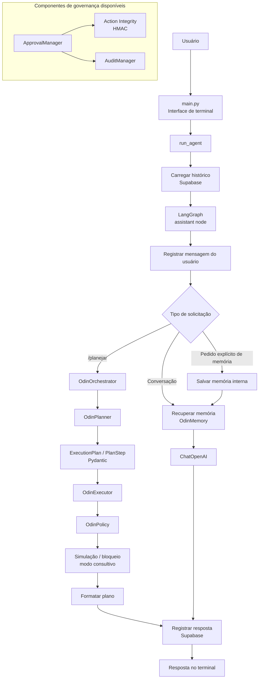

# Arquitetura do JARVIS ODIN

Este documento descreve o fluxo implementado no repositório. Ele distingue os componentes disponíveis na arquitetura do comportamento efetivamente habilitado na versão atual.

## Visão geral

## Componentes

| Componente | Responsabilidade |
|---|---|
| `main.py` | Interface de terminal, comandos e ciclo de sessão |
| `app/agents/first_agent.py` | Inicializa o modelo, memória e grafo LangGraph; processa mensagens |
| `app/planning/planner.py` | Produz planos estruturados com `ExecutionPlan` e `PlanStep` |
| `app/orchestration/orchestrator.py` | Coordena planejamento e processamento das etapas |
| `app/executor/executor.py` | Aplica a política e retorna o estado do processamento |
| `app/security/policy.py` | Classifica ações como automáticas, dependentes de autorização ou bloqueadas |
| `app/security/action_integrity.py` | Canonicaliza ações e calcula/valida assinaturas HMAC |
| `app/approvals/approval_manager.py` | Solicita, consulta, decide e reivindica aprovações no Supabase |
| `app/audit/audit_manager.py` | Registra eventos de auditoria |
| `app/memory/supabase_memory.py` | Persiste memórias, conversas e mensagens no Supabase |
| `app/config/settings.py` | Carrega e valida variáveis de ambiente |

## Fluxo conversacional

1. A interface recebe a mensagem e chama `run_agent`.
2. O agente recupera o histórico persistido para o identificador da conversa.
3. O grafo LangGraph processa a mensagem.
4. O agente registra a mensagem do usuário, recupera as memórias disponíveis e monta o contexto do modelo.
5. A resposta do modelo é registrada no histórico e devolvida à interface.

Pedidos explícitos para guardar uma informação seguem o caminho específico de gravação na memória interna. O agente recebe o resultado da operação para não declarar sucesso quando a gravação falhar.

## Fluxo de planejamento

1. O comando `/planejar` encaminha a tarefa ao `OdinOrchestrator`.
2. O `OdinPlanner` gera um plano estruturado e validado por Pydantic.
3. O orquestrador encaminha cada etapa ao `OdinExecutor`.
4. O executor consulta a `OdinPolicy` e devolve o estado da etapa.
5. O resultado é formatado como proposta consultiva.

## Segurança e limites da versão atual

A versão publicada opera em **modo consultivo**:

- O fluxo de planejamento utiliza `dry_run=True`.
- O executor bloqueia explicitamente chamadas em modo de execução real.
- Não há ferramentas operacionais registradas para executar ações externas.
- Os comandos administrativos de aprovação não são habilitados pela interface principal.
- Os componentes de aprovação, auditoria e integridade estão presentes na base de código, mas sua existência não significa que a execução externa esteja habilitada.

Os módulos de aprovação e auditoria utilizam as tabelas correspondentes do Supabase. Os testes de integração que exercitam essas operações criam, alteram e excluem registros; devem ser executados somente em um projeto Supabase isolado para testes.

## Persistência

O módulo `OdinMemory` utiliza o Supabase para persistir:

- Memórias permanentes em `odin_memory`.
- Conversas em `odin_conversations`.
- Mensagens em `odin_messages`.

Os componentes de aprovação e auditoria utilizam `odin_approvals` e `odin_audit_logs`, respectivamente.

## Verificações da versão publicada

Na revisão local de 16/11/2026:

- 75 testes unitários passaram.
- A compilação dos módulos Python passou.
- A inicialização do grafo LangGraph e da interface de terminal foi verificada.
- A integração real com Supabase permaneceu pendente de validação isolada.

Esses resultados descrevem a revisão realizada nessa data; não representam execução contínua de CI.
